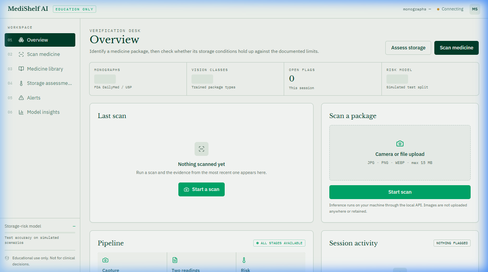
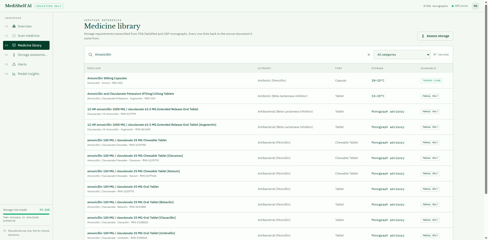
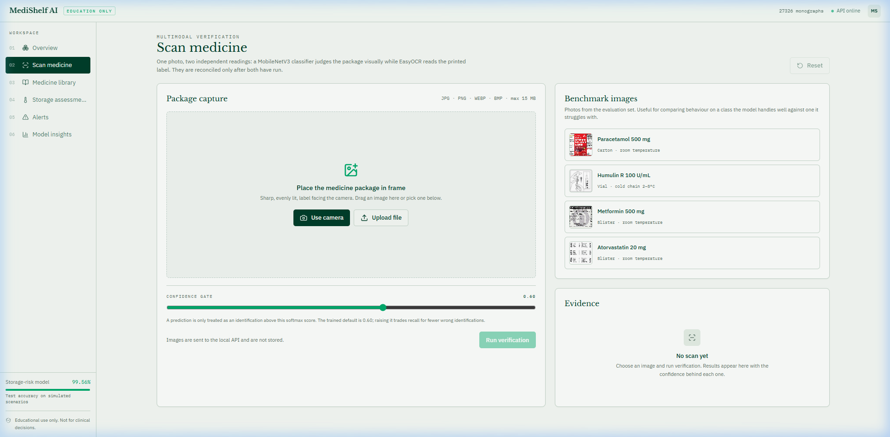
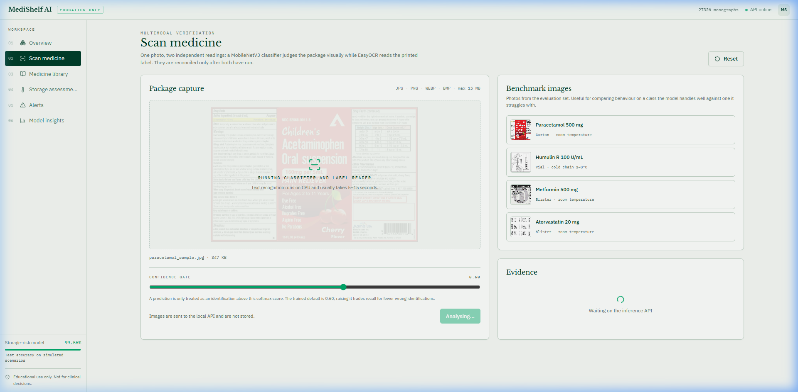
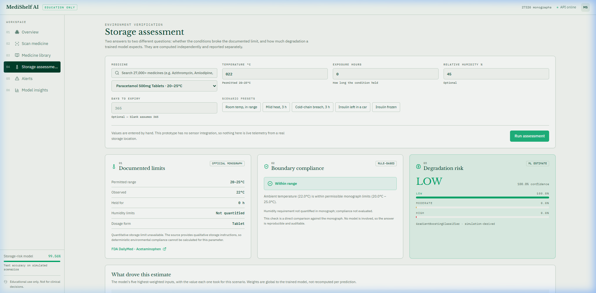
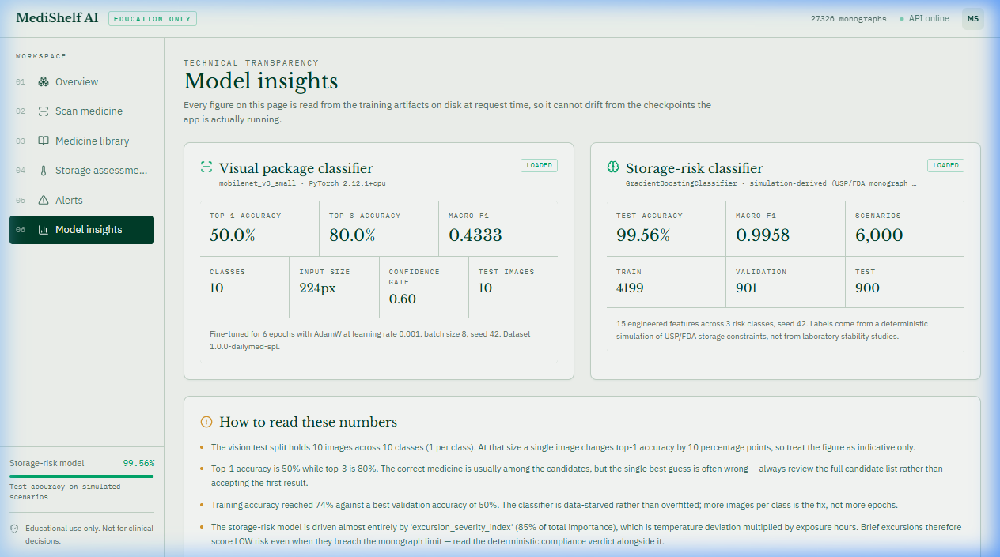
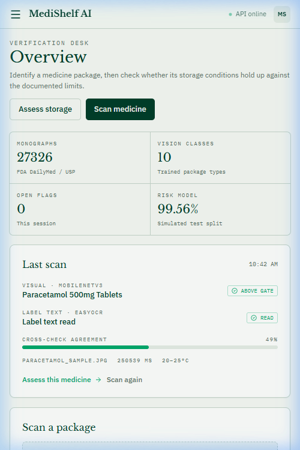
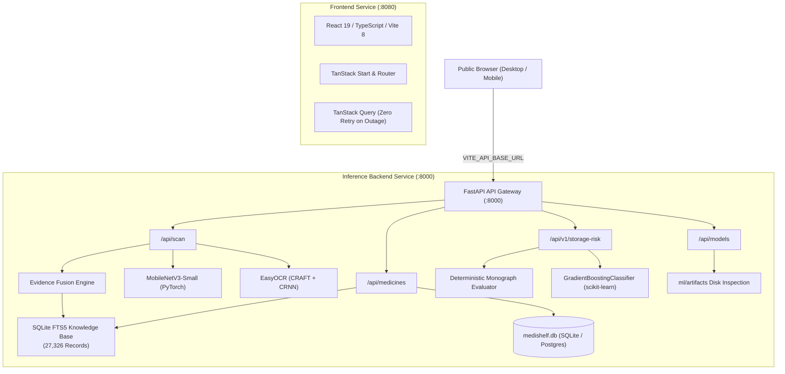

# MediShelf AI — Intelligent Medicine Safety & Storage Compliance Platform

[](tests/backend)
[](src)
[](data/medicines)
[](ml)
[](LICENSE)

**MediShelf AI** is an intelligent medicine safety and storage compliance platform designed for pharmaceutical risk analysis, packaging label extraction, and environmental stability assessment.

It pairs a high-performance **27,326-record authentic medicine knowledge base** (sourced from NLM RxNorm and FDA DailyMed) with a multimodal inference engine: **MobileNetV3-Small** transfer learning for packaging classification, **EasyOCR (CRAFT + CRNN)** with structured regex parsing, an **evidence-based fusion engine**, and a bifurcated **storage-risk prediction pipeline**.

> [!WARNING]
> **Responsible AI & Clinical Disclaimer**
> MediShelf AI is an educational prototype and engineering demonstration. Neither machine learning model is clinically validated. It does not interface with physical temperature/humidity data loggers and must **not** be used to make clinical medication decisions or determine whether an exposed drug is safe for human consumption. Always inspect physical packaging and consult a licensed pharmacist. See [docs/MODEL_LIMITATIONS.md](docs/MODEL_LIMITATIONS.md).

---

## 📸 Product Interface Walkthrough

| 1. System Overview Dashboard | 2. Catalogue Search (27,326 SKUs) |
| :---: | :---: |
|  |  |
| *Real-time service health, indexed metrics, and workflow navigation.* | *FTS5 BM25 search across 27,326 SCD/SBD concepts and 62 categories.* |

| 3. Multimodal Packaging Scanner | 4. Scan Result & Fusion Assessment |
| :---: | :---: |
|  |  |
| *Drag-and-drop packaging photo upload with automated quality checks.* | *Evidence fusion: CV candidate ranking, OCR parsed fields, and consensus.* |

| 5. Storage Compliance & ML Risk | 6. Live Model Insights & Governance |
| :---: | :---: |
|  |  |
| *Monograph rule comparison alongside GradientBoosting excursion risk.* | *Live metrics, confusion matrices, and feature importances from disk.* |

| 7. Responsive Mobile Layout |
| :---: |
|  |
| *Touch-friendly responsive layout optimized for mobile browsers.* |

---

## ⚡ Core Capabilities

1. **Large-Scale Authentic Medicine Catalogue (27,326 SKUs)**:
   - Ingested via official NLM RxNav APIs: **17,610** Semantic Clinical Drug (`SCD`) and **9,691** Semantic Branded Drug (`SBD`) concepts, paired with **25** curated foundation monographs.
   - Sub-millisecond SQLite FTS5 full-text search (`medicines_fts`) and inverted active ingredient index (`40,417` rows across `5,624` distinct ingredients).
   - Zero hallucination: pure RxNorm concepts maintain `NULL` storage limits and return explicit `INSUFFICIENT_DATA` rather than guessing arbitrary default room temperatures.

2. **Multimodal Packaging Scanner & Evidence Fusion**:
   - Automated image quality pre-filtering (Laplacian blur score, brightness, resolution).
   - **MobileNetV3-Small** image classification across 10 packaging classes.
   - **EasyOCR 1.7.2** deep learning text extraction with CLAHE contrast enhancement.
   - Structured parsing for expiry dates (`EXP`, `MM/YYYY`), batch/lot codes, strength, and dosage forms.
   - **Multimodal Decision Fusion**: Categorizes confidence into `CONFIRMED`, `PARTIAL`, `DIVERGENT`, and `UNCONFIRMED` statuses, preventing computer vision from overriding authentic packaging label text.

3. **Bifurcated Storage Risk Engine**:
   - **Deterministic Regulatory Check**: Verifies ambient conditions against official USP/FDA monograph limits.
   - **Machine Learning Risk Model**: Scikit-learn `GradientBoostingClassifier` trained on 15 features (temperature excursion magnitude, cumulative degree-hours, dosage form risk multiplier).
   - Transparent handling of conflicts: distinguishes brief non-damaging temperature excursions from severe cold-chain breaches.

4. **Live Artifact-Backed Model Insights**:
   - Zero hardcoded accuracy claims. The `/api/models` endpoint reads committed checkpoints (`.pth`, `.joblib`) and JSON evaluation outputs directly from disk.
   - Prominently surfaces model limitations and simulation-derived disclaimers.

---

## 🏗️ Architecture & Technology Stack



### Technology Matrix

| Layer | Technologies |
| :--- | :--- |
| **Frontend** | React 19, TypeScript, Vite 8, TanStack Start, TanStack Router, TanStack Query, Tailwind CSS v4, Lucide Icons |
| **Backend API** | Python 3.11, FastAPI, Uvicorn, Pydantic v2, SQLAlchemy 2.0 |
| **Data Layer** | SQLite 3 (WAL mode, FTS5 full-text search), Inverted Ingredient Index, Ingestion Provenance Manifest |
| **Computer Vision** | PyTorch 2.6 (CPU inference), Torchvision 0.21, MobileNetV3-Small |
| **Text Extraction** | EasyOCR 1.7.2, OpenCV Headless, CLAHE, Regex Tokenizer |
| **Machine Learning** | Scikit-learn 1.9.0, Joblib, NumPy 2.2, Pandas 2.3 |
| **Containerization** | Docker, Docker Compose, Nitro (Cloudflare/Node targets) |

---

## 📊 Measured Model Performance & Provenance

To independently audit the evaluation metrics directly from the raw checkpoints on disk, run:
```bash
python tools/verify_models.py
```

### 1. Computer Vision Classifier (MobileNetV3-Small)
- **Trained Classes**: 10 packaging classes (`amoxicillin_500mg`, `aspirin_81mg`, `atorvastatin_20mg`, `cetirizine_10mg`, `ibuprofen_200mg`, `lisinopril_10mg`, `metformin_500mg`, `omeprazole_20mg`, `paracetamol_500mg`, `sertraline_50mg`).
- **Input Size**: $224 \times 224$ pixels.
- **Confidence Gate**: $0.60$.

| Dataset Split | Sample Count | Top-1 Accuracy | Top-3 Accuracy | Macro F1 |
| :--- | :---: | :---: | :---: | :---: |
| **Held-Out Test** (1 per class) | 10 | **50.00%** | **80.00%** | 0.4333 |
| **Validation** | 20 | **50.00%** | **65.00%** | 0.4919 |
| **Training** | 70 | **65.71%** | **95.71%** | 0.6555 |

*Key Takeaway*: Because Top-3 accuracy (80%) significantly exceeds Top-1 (50%), the UI presents ranked candidates rather than a single classification guess, deferring to OCR text when available.

### 2. Storage Risk Classifier (GradientBoostingClassifier)
- **Feature Vector**: 15 numerical and categorical features.
- **Top Feature**: `excursion_severity_index` accounts for **85.19%** of feature importance.
- **Reported Accuracy**: **99.56%** (Macro F1: 0.9958).
- **CRITICAL CAVEAT**: Training labels were derived from Arrhenius kinetics simulations across 6,000 synthetic scenarios. This accuracy reflects mathematical compliance with synthetic kinetics formulas, **not physical stability trial outcomes**.

---

## 🚀 Getting Started

### Prerequisites
- Python 3.11+
- Node.js 20+ and npm

### Local Development Setup

```bash
# 1. Clone the repository
git clone https://github.com/KrishMistry18/MediShelf_AI.git
cd MediShelf_AI

# 2. Set up Python virtual environment & install dependencies
python -m venv .venv
# On Windows:
.venv\Scripts\activate
# On Linux/macOS:
# source .venv/bin/activate

pip install torch==2.6.0 torchvision==0.21.0 --index-url https://download.pytorch.org/whl/cpu
pip install -r backend/requirements.txt

# 3. Install frontend dependencies
npm install

# 4. Start both API backend and web UI concurrently
npm start
```

- Web UI: `http://localhost:8080` (or `3000`)
- Backend API Docs: `http://127.0.0.1:8000/docs`
- Health Endpoint: `http://127.0.0.1:8000/api/health`

---

## 🐳 Staging & Containerized Deployment

### Option A: Docker Compose (Recommended for Staging Demo)

Run the full stack in isolated, production-like containers:

```bash
docker compose up --build -d
```

- Frontend: `http://localhost:8080`
- Backend API: `http://localhost:8000/api/health`

### Option B: Cloud Staging (Render Blueprint)

Deploy using the committed [`render.yaml`](render.yaml):
1. Connect your repository to [Render](https://render.com).
2. Create a new **Blueprint Instance**.
3. Render automatically provisions the Dockerized FastAPI service and Node.js frontend service.

For detailed configuration options, see [docs/DEPLOYMENT.md](docs/DEPLOYMENT.md).

---

## 🧪 Verification & Quality Gate

Every release passes a strict automated quality gate:

```bash
# 1. Backend automated test suite (92/92 tests)
pytest -v tests/backend

# 2. TypeScript compilation check (0 errors)
npm run typecheck

# 3. Production bundle build (Vite + Nitro)
npm run build

# 4. Independent model verification
python tools/verify_models.py

# 5. Live end-to-end API smoke test
python tools/smoke_api.py
```

---

## 📚 Documentation Reference

- **[docs/ARCHITECTURE.md](docs/ARCHITECTURE.md)** — Architectural design, data flow boundaries, and schema contracts.
- **[docs/DEPLOYMENT.md](docs/DEPLOYMENT.md)** — Staging deployment runbook, environment variables, and Docker setup.
- **[docs/DEMO_GUIDE.md](docs/DEMO_GUIDE.md)** — Step-by-step 5-minute presentation script for evaluators and vivas.
- **[docs/MODEL_LIMITATIONS.md](docs/MODEL_LIMITATIONS.md)** — Deep dive into model architectures, biases, and clinical boundaries.
- **[docs/DEVELOPMENT.md](docs/DEVELOPMENT.md)** — Developer onboarding, virtual environment conventions, and testing workflows.

---

## ⚖️ License & Ethical Use

Distributed under the MIT License. Designed strictly for educational and engineering research. MediShelf AI does not provide medical advice or drug dispensation guidance.
